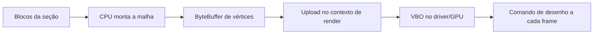

# VBO no Minecraft 1.8.9 e no OptiFine HD_U_M5

> Registro histórico da investigação anterior à integração. A partir da 0.1.1, o Dolly encapsula o OptiFine M5 e usa seus backends nativos; o [guia atual](../primeiro-teste.md) descreve o build e os controles.

## Resultado para o Dolly

O Minecraft 1.8.9 **já possui VBO sem OptiFine**. Podemos testar o Dolly sem OptiFine e ainda usar esse backend, conforme suporte gráfico e opção do jogo. O OptiFine acrescenta uma gestão compartilhada de buffers chamada **Render Regions**, além de verificações e integração com outros recursos.

O primeiro teste do Dolly permanece sem OptiFine por padrão. Esta tarefa só investigou artefatos e atualizou documentação; nenhuma integração ou renderização do Dolly foi implementada.

## Artefatos e método

- Alvo fornecido: `references/OptiFine_1.8.9_HD_U_M5.jar`.
- SHA-256: `2739760a70fca6ae5c7dc817bcc6283f18f55e38fa23778da7f387a6b724b2c4`.
- Base local usada para reconstruir os patches: `minecraft-1.8.9-client.jar`, da instalação PrismLauncher; SHA-256 `14f0d96d1a56fb4f5c3b2233d00699525893fe5ce3dcf181e7de59120595d298`.
- A base não contém `Config.class` do OptiFine. Foram comparados os métodos VBO originais com as versões reconstruídas.
- O instalador contém 467 classes completas e patches diferenciais para outras classes. Um decodificador GDIFF offline reconstruiu **218 patches de classes**, com **todos os MD5 de saída declarados pelo próprio pacote conferidos**. Recursos não relacionados não foram reconstruídos.
- A reconstrução leu dados do pacote; não executou o instalador, as classes do jogo ou chamadas OpenGL. Não alterou a instalação Minecraft existente.
- REA confirmou identidade e inventário: `ev_6b0b97a2e73c251b24374ee930ac8606b0c09e567194fb639a3aa5bf4e5282ad`.
- Inspeção posterior em bytecode JVM, com referências simbólicas do constant pool. Trechos usam offsets originais; não são código-fonte original recuperado.
- [Manifesto com hashes e verificação](evidence/manifest.json).

## O que é o VBO neste pipeline

Um Vertex Buffer Object é um buffer OpenGL usado para guardar dados de vértices em memória administrada pelo driver/GPU. Aqui ele guarda a geometria já montada dos blocos: posições, cores, coordenadas de textura e iluminação.

A CPU continua calculando a malha. Quando um chunk de render precisa ser atualizado, o jogo monta esses dados e os envia ao buffer. Na apresentação dos frames, o render referencia o buffer e pede o desenho da geometria. VBO não elimina reconstrução de chunks, cálculo de visibilidade, ordenação de transparências ou custo de shaders.

Um chunk de render neste fluxo representa uma seção de **16×16×16 blocos**, com buffers separados por camada de renderização. Não confundir com a coluna inteira de um chunk do mundo.

O caminho alternativo sem VBO examinado usa **display lists**, que também armazenam trabalho de renderização. Portanto não é correto dizer que VBO troca um caminho que necessariamente recalcula ou reenvia toda a geometria em todo frame. A comparação de desempenho depende do driver e da cena.

## O VBO que já existe no vanilla

`bmt` é o objeto de buffer de vértices usado pelos chunks. Na base 1.8.9:

1. O construtor cria um identificador de buffer por `bqs.e()`.
2. `bmt.a(ByteBuffer)` faz bind e chama o wrapper de `glBufferData` com uso `35044` (`GL_STATIC_DRAW`). Calcula a quantidade de vértices pelo tamanho dos dados dividido pelo stride do formato.
3. `bmt.a(int)` desenha com `GL11.glDrawArrays(mode, 0, count)`.
4. `bmt.c()` libera o identificador com o wrapper de `glDeleteBuffers`.

`bqs` é OpenGlHelper. Ele usa OpenGL 1.5 ou a extensão `ARB_vertex_buffer_object`, selecionando wrappers core/ARB conforme as capacidades disponíveis. No vanilla, `bqs.f()` só habilita o caminho quando há suporte **e** a opção `useVbo` está ligada.

**Conclusão comprovada pela comparação:** essa cadeia existe no JAR vanilla; não é uma função que precisaria ser extraída do OptiFine para existir no Dolly.

Evidência: [vanilla-vbo.bytecode.txt](evidence/vanilla-vbo.bytecode.txt).

### A opção aparece no menu vanilla?

Sim. A tela de vídeo vanilla `ayb` inclui `avh$a.x` (`USE_VBO`, tradução `options.vbo=Use VBOs`) no array de opções, índice 14. Em `ayb.b()`, offsets 67–172, a tela monta uma lista alternativa sem essa opção quando `bqs.P` indica ausência de suporte. Portanto a presença da opção na interface depende das capacidades detectadas do contexto OpenGL. Isso não demonstra qual capacidade foi detectada na instalação do usuário.

Evidência: [vanilla-video-menu.bytecode.txt](evidence/vanilla-video-menu.bytecode.txt).

## O que Render Regions acrescenta

### Buffers compartilhados por região e camada

No caminho comum, diferentes seções/camadas têm seus próprios buffers. Com Render Regions, `ViewFrustum` (`bga`) cria grupos espaciais usando `(x >> 8) << 8` e `(z >> 8) << 8`: regiões de **256×256 blocos em X/Z**. A chave não divide por Y. Para cada grupo, mantém um `VboRegion` por camada.

Cada buffer de seção (`bmt`) passa a apontar para:

- Um `VboRegion`, dono do armazenamento compartilhado.
- Um `VboRange`, com posição e tamanho de sua geometria dentro dele.

Ao associar uma região, `bmt.setVboRegion` libera seu antigo buffer individual. O render usa coordenadas relativas à origem regional e uma transformação comum em vez de uma transformação por seção nesse caminho.

Locais: `bga.updateVboRegion`, `bmt.setVboRegion`, `bht.a(bfd,cj)` e `bfy.preRenderRegion`. Ver [vbo-pipeline.bytecode.txt](evidence/vbo-pipeline.bytecode.txt).

### Upload e alocação

`VboRegion` começa com capacidade de **4.096 vértices**, não 4.096 bytes. O tamanho por vértice vem do formato ativo (`bms.a.g()`). O caminho sem shaders encontrado em `bfy.a()` usa stride de **28 bytes**: posição em 0, cor em 12, UV em 16 e iluminação em 24. Nesse formato, a alocação inicial é 112 KiB por buffer regional. Shaders podem trocar o formato, portanto 28 bytes não é um tamanho universal.

`bufferData(ByteBuffer,VboRange)`:

- Remove o range quando não há dados.
- Reutiliza sua posição quando o novo tamanho cabe.
- Quando a malha cresce, coloca o range no topo do espaço utilizado.
- Expande o armazenamento quando necessário.
- Envia os bytes com `glBufferSubData`, usando offset do range convertido para bytes.

`expandVbo` aumenta a capacidade em passos de **1,5×** até caber, aloca outro buffer, copia a capacidade anterior com `glCopyBufferSubData` e apaga o buffer antigo. Há custo de realocação; não significa upload gratuito.

### Desenho em lote

`VboRegion.drawArrays(mode,range)` não desenha imediatamente: acrescenta posição inicial e quantidade aos arrays `first/count`.

`VboRegion.finishDraw` faz bind, prepara os ponteiros do formato e chama o wrapper de **`glMultiDrawArrays`**. `bfy` finaliza o lote quando muda o grupo/região e no fim da lista.

Isso reduz chamadas e trocas de estado na fronteira Java/driver. Não significa que a GPU desenha toda a região: só os ranges enfileirados pelo render entram no lote. Também não é um index buffer/EBO; os arrays contêm início e quantidade de vértices.

### Compactação e custo de memória

Remover ou realocar malhas deixa espaços vazios. Se `positionTop` ultrapassa `sizeUsed * 11 / 10`, o código tenta `compactRanges(1)` em pontos de upload/finalização.

Essa compactação é incremental: limita ranges examinados, **não bytes copiados nem tempo máximo por frame**. Move conteúdo com cópia de buffer; evita sobrepor origem e destino usando outro posicionamento quando necessário. Compactar reduz fragmentação, mas não encolhe automaticamente a capacidade de armazenamento OpenGL observada.

Esses detalhes podem importar para travadas de frame e uso de memória em cenas que mudam muito. Não foram medidos neste ambiente.

Evidência direta: [vbo-region.bytecode.txt](evidence/vbo-region.bytecode.txt).

## CPU, threads e ciclo de vida

`ChunkRenderDispatcher` (`bho.a(adf,bfd,bht,bhq)`) confere se está no thread principal/contexto de render (`ave.aJ()`). Nesse contexto, envia ao VBO ou compila a display list, conforme o backend. Fora dele, enfileira um `ListenableFutureTask` para o trabalho de upload.

Portanto montar uma malha em worker não significa fazer chamadas OpenGL livremente desse worker. Há coordenação entre construção CPU e envio ao contexto gráfico.

Alterar `useVbo` ou Render Regions provoca `RenderGlobal` (`bfr.a()`) a recalcular o backend e reconstruir estruturas. `bga.deleteVboRegions` libera os buffers compartilhados e limpa o mapa. Não é apenas mudar uma flag e reutilizar todas as estruturas anteriores.

## Requisitos e opções que mudam o resultado

| Condição | VBO vanilla | Com OptiFine M5 |
| --- | --- | --- |
| Suporte básico | OpenGL 1.5 ou ARB VBO | Mesmo requisito básico |
| Opção `useVbo` | Precisa estar ligada | Também precisa |
| Render Regions | Não existe esse recurso | Exige suporte adicional: `(OpenGL 3.1 ou ARB_copy_buffer) e OpenGL 1.4` |
| Render Regions ligado sem suporte adicional | Não se aplica | `bqs.f()` desliga o caminho VBO inteiro; desativar Regions pode permitir VBO simples |
| Modo MultiTexture do OptiFine | Não se aplica | AF efetivo >1 ou AA efetivo >0 desliga esse caminho VBO |
| Fast Render | Não se aplica como opção OF | Não é um bloqueio direto de `bqs.f()` |

O modo `Config.isMultiTexture()` não é a mesma coisa que a existência de suporte OpenGL a múltiplas texturas. Os bloqueios são próprios dessa implementação OptiFine, não proibições universais de VBO com antialiasing/filtragem.

`bqs.i()` é um gate de **framebuffer**, não de VBO. Fast Render e AA aparecem nesse gate, o que explica interações com efeitos que usam framebuffer. Não resumir isso como “Fast Render desliga VBO”.

A string de diagnóstico de Regions cita OpenGL 1.3, mas a verificação encontrada testa o campo `OpenGL31`. O relatório usa a condição do bytecode, não a mensagem.

Evidência: [vbo-gates.bytecode.txt](evidence/vbo-gates.bytecode.txt).

## Valores iniciais desta versão

No OptiFine **1.8.9 HD_U_M5** examinado, `useVbo`, `ofRenderRegions` e `ofFastRender` começam falsos no construtor. A base vanilla comparada também começa com `useVbo=false`. Arquivos pessoais podem mudar esses valores.

Esses defaults não devem ser confundidos com o CMClient 1.8.8 analisado antes: é outro pacote, com outras alterações e outra versão do OptiFine. Copiar seus padrões ou heurísticas de GPU não é necessário para testar VBO no vanilla.

## Aplicação futura ao Dolly

Para o primeiro teste sem OptiFine, o menor caminho é usar a implementação VBO da própria 1.8.9, expondo a opção e verificando qual backend foi efetivamente escolhido. Comparar VBO ligado/desligado na mesma cena, resolução e limite de FPS, registrando tempos por frame e reconstrução de chunks.

Só faz sentido reproduzir o alocador regional depois de demonstrar gargalo em chamadas ao driver/binds e medir o custo de cópias e memória. VBO não altera alcance, clique, física ou registro de golpes no servidor; eventual melhora de resposta viria indiretamente de frames mais consistentes.

## Cobertura e limites

| Pergunta | Estado |
| --- | --- |
| O vanilla 1.8.9 tem VBO? | Comprovado nas classes da base |
| Como cria, envia, desenha e libera? | Rastreado nos caminhos descritos |
| O que o OptiFine acrescenta? | Rastreado pooling regional, ranges, multidraw, expansão e compactação |
| Quais gates e opções escolhem os caminhos? | Rastreado estático, incluindo reload e fallback |
| Funciona melhor na GPU/Linux do usuário? | Não medido |
| Há regressões com transparência, shaders ou mudanças rápidas do mundo? | Não testado em execução |

Não foi executado o jogo, feito benchmark ou modificado o pipeline de render do Dolly. A reconstrução verificada estabelece o conteúdo das classes e seus caminhos estáticos; não comprova ganhos de FPS, latência, localização física da memória ou compatibilidade de driver em runtime.
